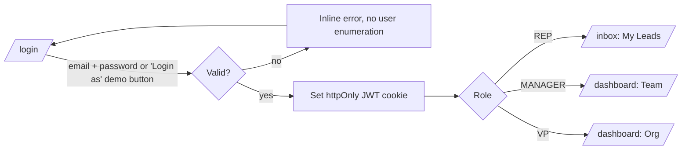
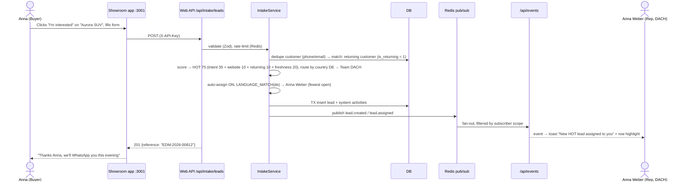
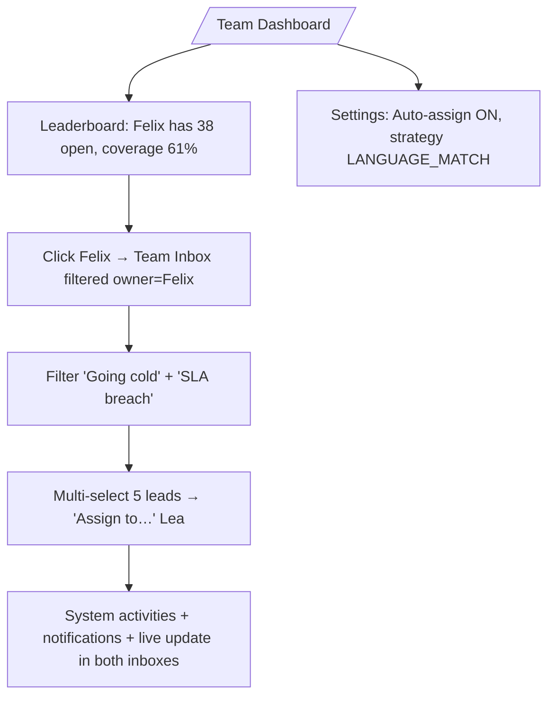
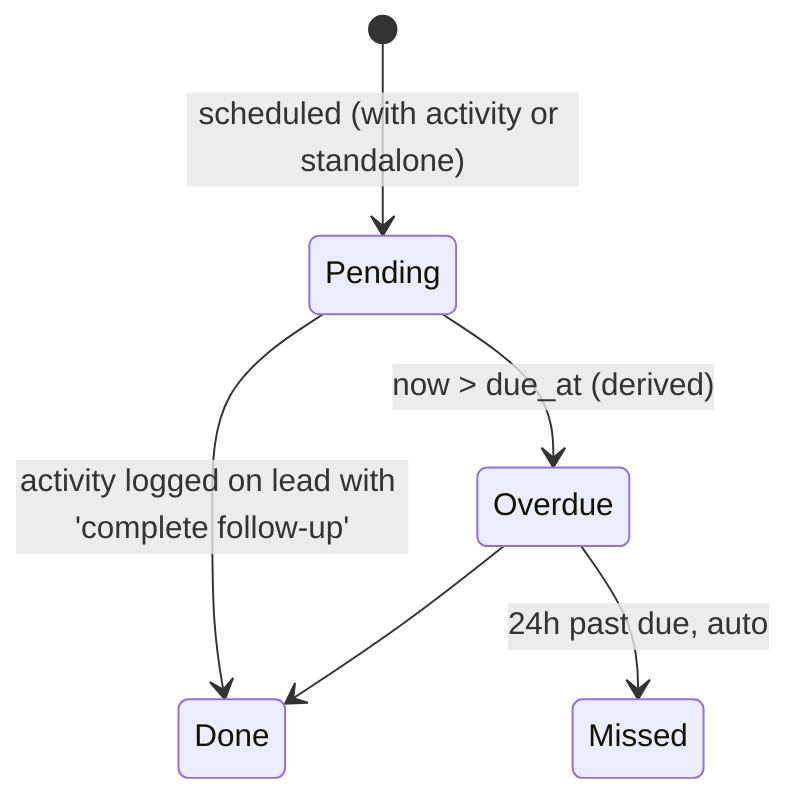

# 02 — User Flows

Mermaid diagrams render on GitHub and in VS Code. Each flow lists the features it touches.

---

## UF-1 · Login & landing (F02, F03)

- Visiting a protected route without a valid token redirects to `/login?next=<path>`.
- Logout clears the cookie and revokes the token's `jti` in Redis.

---

## UF-2 · Rep works the inbox: the core loop (F04, F05, F06, F09, F14) · covers R1 + R2 + R3
```mermaid
sequenceDiagram
  actor Rep as Sofia (Rep)
  participant Inbox
  participant Detail as Lead Detail
  participant API
  participant DB
  Rep->>Inbox: Opens /inbox (sorted: overdue → SLA → score)
  Inbox->>API: GET /api/leads?view=mine
  API->>DB: scoped query
  DB-->>Inbox: rows
  Rep->>Detail: Clicks "Giulia Conti · HOT 82"
  Detail->>API: GET /api/leads/:id (+ activities, offers, follow-ups)
  Rep->>Detail: Clicks ★ WhatsApp (preferred)
  Detail-->>Rep: Opens wa.me link with template; composer pre-filled (type=WhatsApp)
  Rep->>Detail: Picks outcome "Interested", note, next follow-up tomorrow 18:00, stage → QUALIFIED
  Detail->>API: POST /api/leads/:id/activities
  API->>DB: TX: activity + stage_history + follow_up + lead update + score recompute
  API-->>Detail: 201 + updated lead
  Detail-->>Rep: Timeline shows entry at top (optimistic, then confirmed)
  Note over Rep,DB: Refresh or restart → entry still there (R3)
```

---

## UF-3 · Buyer submits an enquiry → lead appears live (F13, F10, F09, F11, F12) · headline demo moment

Anna is a **returning customer**: she bought a car years ago, has no open lead, and no lead with activity in the last 90 days. That gives her +10 customer value (HOT 75, see the F09 worked example A'), and the sticky-owner rule (F10 FR-012) doesn't apply, so normal country routing and auto-assignment run. With an open or recently active lead, she would go straight to that lead's owner and team.

---

## UF-4 · Rep claims from the unassigned pool (F11, F12)
```mermaid
flowchart LR
  A[Inbox tab: Unassigned] --> B[Click 'Claim' on lead]
  B --> C{Still unassigned? and rep open leads < 25?}
  C -- yes --> D[owner = rep, system activity 'Claimed by …', broadcast]
  C -- already claimed --> E[Toast: 'Claimed by Jonas a moment ago', row removed]
  C -- over limit --> F[Toast: 'Claim limit reached (25 open)']
```
Claiming uses a conditional update (`WHERE owner_id IS NULL`), so two reps can't claim the same lead.

---

## UF-5 · Manager rebalances and intervenes (F16, F11, F08)


---

## UF-6 · Follow-up lifecycle & going cold (F08, F07)

Lead-level: no activity for 3 days → **At risk** badge. No activity for 7 days, or 3 unanswered attempts in a row → auto stage **COLD** (system activity). A rep can revive a COLD lead by logging an activity, which moves it to CONTACTED.

---

## UF-7 · Closing a lead (F07, F16)
- **WON:** the rep sets stage WON, enters a deal value (€, required) and the vehicle, optionally links an applied offer, and `closed_at` is set. The dashboard revenue updates live.
- **LOST:** the rep must pick a reason (Price, Bought elsewhere, Not ready, Unreachable, Financing declined, Other with text).

---

## UF-8 · VP reviews the org (F16, F17, F15)
1. The Org Dashboard shows KPIs (leads, coverage, FRT, conversion, revenue €), the funnel, and source performance.
2. Team comparison table: DACH vs West vs South.
3. Demographics tab: conversion and channel preference by age band, and model interest heatmap.
4. Offers: create a "Winter Trade-in Bonus €1,500" for customers with a trade-in, valid 1 Oct–31 Dec. It immediately appears on matching leads.

---

## UF-9 · AI assist on a lead (F18)
1. The rep opens a lead. An "AI Assist" card shows a **summary** (3–4 lines) and a **next best action** with a reason.
2. "Draft message" produces a message in the customer's **language** and **preferred channel** tone, including an applicable offer.
3. The rep edits it, clicks send via the deep link, and the activity is logged with a marker that the draft was AI-assisted.
4. With no API key or on error, a rule-based suggestion is shown, labelled "Rule-based".

---

## UF-10 · Load simulation for the demo (F10)
`npm run simulate -- --rate 5 --count 20` posts random realistic EU leads to the intake API. The inbox and dashboard update live.

---

## Screen Inventory
| Route | App | Roles | Feature |
|---|---|---|---|
| `/login` | web | public | F02 |
| `/inbox` (tabs: Mine, Unassigned, Due today, Going cold, Team/All) | web | all | F04, F11 |
| `/leads/[id]` | web | scoped | F05, F06, F07, F08, F14, F15, F18 |
| `/pipeline` (Kanban) | web | all | F07 |
| `/dashboard` | web | all (content by role) | F16, F17 |
| `/team/settings` | web | MANAGER, VP | F11 |
| `/offers` | web | VP (edit), others (read) | F15 |
| `/audit` | web | MANAGER, VP | F19 |
| `/` , `/models/[slug]` , enquiry modal, thank-you | showroom | public | F13 |
