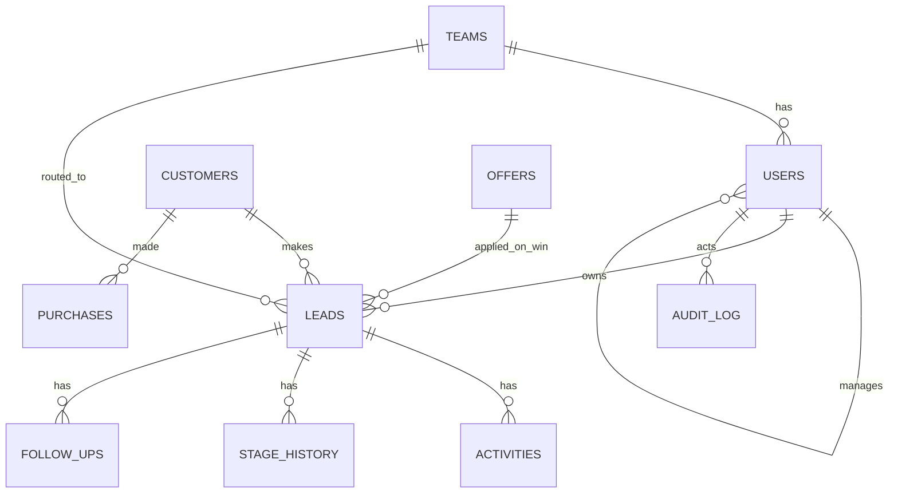
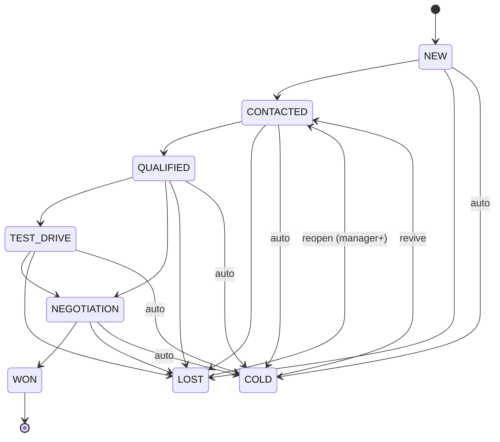

# 03 — Domain Model

**Ownership:** F01 creates the **entire schema, enums, and shared contracts** up front (D11). Other features consume them. Changing the schema after F01 needs a migration plus an update to this doc.

## 1. Entity Relationship Diagram


## 2. Tables
All IDs are `TEXT` (ULID, so they're sortable and safe to expose). Timestamps are `INTEGER` unix ms (UTC). Money is `INTEGER` euro cents.

### teams
| col | type | notes |
|---|---|---|
| id | text pk | |
| name | text | "Team DACH" |
| region | text | DACH / WEST / SOUTH |
| countries | json | `["DE","AT","CH"]` (ISO-3166 alpha-2) |
| manager_id | text fk users | |
| auto_assign | int bool | default 1 |
| assign_strategy | text enum | `LOAD_BALANCED` (default), `LANGUAGE_MATCH`, `ROUND_ROBIN` |
| rr_cursor | text null | last user id picked by round-robin |

### users
| col | type | notes |
|---|---|---|
| id | text pk | |
| name, email (unique, lowercase) | text | |
| password_hash | text | bcrypt |
| role | enum | `REP`, `MANAGER`, `VP` |
| manager_id | text fk users null | null for VP (root) |
| team_id | text fk teams null | null for VP |
| languages | json | `["de","en"]` ISO-639-1 |
| avatar_color | text | |
| is_active | int bool | |
| max_open_leads | int | default 25 (claim limit) |
| last_assigned_at | int null | load-balancer tie-break |
| token_version | int | incremented to revoke all sessions |
| created_at | int | |

### customers
| col | type | notes |
|---|---|---|
| id | text pk | |
| first_name, last_name | text | |
| email | text null | normalized lowercase, indexed |
| phone | text null | **E.164** normalized (`+4915112345678`), indexed |
| country | text | ISO alpha-2 |
| city | text | |
| age | int null | |
| age_band | enum | `18-25`,`26-35`,`36-45`,`46-60`,`60+`,`UNKNOWN` |
| language | text | ISO-639-1 |
| preferred_channel | enum | `CALL`,`WHATSAPP`,`SMS`,`EMAIL` |
| secondary_channel | enum null | |
| best_time | enum | `MORNING`,`AFTERNOON`,`EVENING`,`ANYTIME` |
| is_returning | int bool | **stored column**, set by the seed, intake dedupe (F10) when a prior lead or purchase exists, and F07 on WON |
| marketing_consent | int bool | GDPR placeholder |
| search_text | text | lowercased, diacritics-stripped `first last email phone-digits`, maintained by the customer repository on insert/update, indexed (accent-insensitive inbox search, F04) |
| created_at | int | |

Constraint: at least one of email or phone.

### leads
| col | type | notes |
|---|---|---|
| id | text pk | |
| reference | text unique | human-readable `EDM-2026-00812` |
| customer_id | text fk | |
| team_id | text fk | |
| owner_id | text fk users null | null = unassigned pool |
| source | enum | see §4 |
| source_detail | text null | campaign, portal name, referrer |
| stage | enum | see §3 |
| vehicle_model | text null | slug of a showroom model |
| budget_min, budget_max | int null | euro cents |
| has_trade_in, wants_finance, test_drive_requested | int bool | |
| message | text null | buyer's free text |
| score | int | 0–100 |
| priority | enum | `HOT`,`WARM`,`COOL` |
| score_breakdown | json | `{intent:22, source:10, customer:10, freshness:20, engagement:0}` |
| attempt_count | int | consecutive unanswered attempts |
| deal_value | int null | euro cents, set on WON |
| applied_offer_id | text fk null | |
| lost_reason | enum null | + `lost_note` text |
| first_response_at, last_activity_at, last_contact_at, assigned_at, closed_at | int null | `last_activity_at` = any USER activity (incl. NOTE); `last_contact_at` = last **contact activity** (USER, type ≠ NOTE). At-risk and COLD timers use `coalesce(last_contact_at, created_at)` |
| created_at, updated_at | int | |
| version | int | optimistic concurrency |

### activities (append-only)
| col | type | notes |
|---|---|---|
| id | text pk | |
| lead_id | text fk | |
| actor_id | text fk null | null for system |
| kind | enum | `USER` or `SYSTEM` |
| type | enum | USER: `CALL`,`WHATSAPP`,`SMS`,`EMAIL`,`MEETING`,`TEST_DRIVE`,`NOTE` · SYSTEM: `LEAD_CREATED`,`STAGE_CHANGED`,`ASSIGNED`,`CLAIMED`,`FOLLOW_UP_SCHEDULED`,`FOLLOW_UP_MISSED`,`AUTO_COLD`,`OFFER_APPLIED`,`SCORE_CHANGED` |
| outcome | enum null | `CONNECTED`,`NO_ANSWER`,`VOICEMAIL`,`INTERESTED`,`NOT_INTERESTED`,`CALLBACK_REQUESTED` |
| note | text | 1–2000 chars for USER |
| ai_assisted | int bool | |
| metadata | json | e.g. `{from:"NEW", to:"CONTACTED"}` |
| created_at | int | |

### stage_history
`id, lead_id, from_stage, to_stage, changed_by (null=system), reason, changed_at`

### follow_ups
`id, lead_id, assigned_to, due_at, status (PENDING|DONE|MISSED|CANCELLED), note, created_by, created_at, completed_at, completed_by_activity_id`

### offers
`id, title, description, discount_type (AMOUNT|PERCENT|APR|GIFT), value (cents, basis points, or null), valid_from, valid_to, eligibility json, is_active, created_by, created_at`

Eligibility JSON: every key is optional, and all present keys must match (AND):
```json
{ "customerType": "RETURNING" | "NEW" | "ANY",
  "models": ["aurora-suv"], "countries": ["DE","AT"],
  "requiresTradeIn": true, "requiresFinance": true,
  "minBudget": 2500000, "sources": ["REFERRAL"] }
```

### purchases
`id, customer_id, lead_id (null for historical seed purchases), vehicle_model, amount (cents), purchased_at`
Marking a lead **WON inserts a `purchases` row** (vehicle_model, deal_value) in the same transaction (F07), which keeps returning-customer detection consistent.

### audit_log (append-only)
`id, actor_id (null=system/intake), action, entity, entity_id, before json, after json, meta json (actorType, userAgent, method, strategy …), ip, created_at`

**Append-only enforcement:** SQLite triggers (`BEFORE UPDATE` / `BEFORE DELETE` → `RAISE(ABORT)`) on both `activities` and `audit_log` (F01 FR-015).

### Indexes
`leads(owner_id, stage)`, `leads(team_id, owner_id)`, `leads(created_at)`, `leads(last_activity_at)`, `leads(stage, last_contact_at)`, `leads(source)`, `leads(priority, score)`, `activities(lead_id, created_at)`, `follow_ups(assigned_to, status, due_at)`, `customers(phone)`, `customers(email)`, `customers(search_text)`, `purchases(customer_id)`, `stage_history(lead_id, changed_at)`, `audit_log(entity, entity_id)`, `audit_log(created_at)`.

## 3. Lead Stage State Machine

- Backward moves between open stages are allowed (for example NEGOTIATION → QUALIFIED) and are recorded.
- Open stages: NEW, CONTACTED, QUALIFIED, TEST_DRIVE, NEGOTIATION. Closed: WON, LOST. Dormant: COLD.
- **Contact activity** = a USER activity whose type ≠ `NOTE` (an internal note isn't customer contact).
- Logging the first **contact activity** on a NEW lead moves it to CONTACTED automatically. A contact activity on a COLD lead revives it to CONTACTED. A NOTE never advances the stage, never sets `first_response_at`, doesn't count toward coverage, and leaves `attempt_count` unchanged.
- The transition table and these rules live in `packages/shared/src/stage-machine.ts` (owned by F01: `TRANSITIONS`, `canTransition`, `autoAdvance`, `isContactActivity`).

## 4. Enums (in `packages/shared/src/enums.ts`)
- **LeadSource:** `WEBSITE`, `FACEBOOK`, `INSTAGRAM`, `GOOGLE_ADS`, `PORTAL` (e.g. mobile.de, AutoScout24, as source_detail), `WALK_IN`, `PHONE`, `REFERRAL`
- **SourceGroup** (`packages/shared/src/source-groups.ts`): `WEBSITE` (WEBSITE), `SOCIAL` (FACEBOOK, INSTAGRAM), `PAID_SEARCH` (GOOGLE_ADS), `PORTALS` (PORTAL), `OFFLINE` (WALK_IN, PHONE), `REFERRAL` (REFERRAL). Used by F16 charts and the F04 `sourceGroup` filter
- **Stage**, **Priority**, **ActivityType**, **Outcome**, **Channel**, **BestTime**, **AgeBand**, **LostReason** (`PRICE`,`BOUGHT_ELSEWHERE`,`NOT_READY`,`UNREACHABLE`,`FINANCING_DECLINED`,`OTHER`), **Role**, **AssignStrategy**, **FollowUpStatus**
- **Vehicle catalog** (showroom and seed): `aurora-suv` €38,900 · `metro-hatch` €21,500 · `vento-sedan` €32,400 · `terra-4x4` €54,900 · `luma-ev` €42,700 · `nova-van` €36,200

## 5. Event Catalog (Redis pub/sub channel `leaddesk:events`, defined in `packages/shared/src/events.ts`)
| Event | Payload (+ always `teamId`, `ownerId`, `at`, `by` = actor user id or `null` for system/intake) | Producer | Consumers |
|---|---|---|---|
| `lead.created` | lead summary row | F10 | inbox, dashboard |
| `lead.assigned` | leadId, fromOwnerId, toOwnerId, by, method (`AUTO`/`MANUAL`/`CLAIM`) | F10, F11 | inbox, toast |
| `lead.updated` | leadId, changed fields (stage, score, priority…) | F06, F07, F09 | inbox row, detail |
| `activity.created` | activity row | F06, system | detail timeline |
| `followup.due` | followUpId, leadId | F08 | toast |
| `offer.changed` | offerId | F15 | offers strip, cache |

SSE filter: deliver when `ownerId ∈ scope(user)`, or when `ownerId = null` and `teamId ∈ teams(scope)`.

## 6. Derived Metrics (definitions used everywhere; SQL lives in F16)
| Metric | Definition |
|---|---|
| New leads | count(leads) with created_at in period, in scope |
| Coverage % | leads in period with ≥ 1 **contact activity** (USER, type ≠ NOTE) ÷ leads in period |
| Avg FRT | avg(first_response_at − created_at) for leads with a response (`first_response_at` = time of the first contact activity) |
| SLA breach | stage = NEW and no contact activity and age > (HOT ? 15 min : 2 h) |
| Conversion % | WON ÷ (WON + LOST) for leads closed in period |
| Win rate by source | same, grouped by source |
| Revenue | sum(deal_value) of WON leads, closed_at in period |
| Pipeline value | sum(budget_max) of open leads |
| Stage aging | avg time between consecutive stage_history entries per stage |
