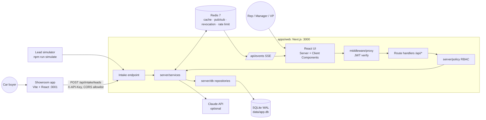

# 04 — Architecture

## 1. System Context


## 2. Repository Layout (npm workspaces monorepo)
```
/
├─ apps/
│  ├─ web/                      Next.js (App Router, TypeScript), port 3000
│  │  ├─ app/                   routes: (auth)/login, (app)/inbox, leads/[id], dashboard, pipeline, team/settings, offers, audit
│  │  │  └─ api/                thin route handlers
│  │  ├─ components/            ui/ (shadcn), leads/, timeline/, dashboard/, layout/
│  │  ├─ lib/                   client utils, query client, sse hook, formatters (EUR, dates)
│  │  ├─ server/
│  │  │  ├─ auth/               jwt.ts, password.ts, session.ts, getCurrentUser()
│  │  │  ├─ policy/             scope.ts (recursive CTE), authorize.ts
│  │  │  ├─ services/           lead, activity, stage, followup, scoring, intake, routing, assignment, offer-matcher, dashboard, ai, audit
│  │  │  ├─ channels/           ChannelAdapter, DeepLinkAdapter
│  │  │  ├─ redis/              client.ts (lazy ioredis singletons, degraded status)
│  │  │  ├─ http/               errors.ts (AppError, JSON error shape), request logging
│  │  │  ├─ events/             bus.ts (Redis pub/sub + in-proc fallback)
│  │  │  ├─ cache/              cache.ts (strategy per F20)
│  │  │  ├─ jobs/               cold-detector, followup-sweeper (setInterval, started once)
│  │  │  └─ db/                 client.ts, schema.ts, migrations/ (incl. append-only triggers), seed/, repositories/, audit.ts (writer)
│  │  ├─ scripts/               simulate.ts
│  │  └─ tests/                 unit (vitest), e2e (playwright)
│  └─ showroom/                 Vite + React + Tailwind, port 3001
├─ packages/
│  └─ shared/                   enums, Zod schemas (intake, activity, lead filters), event types, stage-machine, source-groups, scoring weights, formatters
├─ docs/                        this spec
├─ docker-compose.yml           redis (and optional app containers)
├─ .env.example
└─ package.json                 workspaces + scripts: dev, db:reset, simulate, test, lint
```

**Layering rule:** `route handler → (authenticate, validate with Zod) → policy.authorize → service → repository`. Services never import from `app/` or Next.js APIs. That keeps the core extractable into a standalone service.

## 3. Tech Stack
| Concern | Choice | Notes |
|---|---|---|
| Language | TypeScript (strict) everywhere | |
| Web framework | **Next.js** latest stable, App Router, Node runtime | RSC for read-heavy pages |
| Showroom | **Vite + React + Tailwind** | Deliberately separate and tiny |
| UI kit | Tailwind CSS + **shadcn/ui** (Radix), lucide icons | |
| Tables | TanStack Table | |
| Client data | TanStack Query (mutations, optimistic updates, SSE-driven invalidation) | |
| Charts | Recharts | |
| DB | **SQLite** via `better-sqlite3`, WAL | Fallback driver `@libsql/client` if native build fails on Node 24/Windows |
| ORM/migrations | **Drizzle ORM** + drizzle-kit | |
| Cache / pub-sub | **Redis 7** (Docker) via `ioredis` | |
| Validation | Zod (shared package) | |
| Auth | `jose` (JWT HS256) + `bcryptjs`, httpOnly cookie | |
| IDs | `ulid` | |
| Phone normalization | `libphonenumber-js` | E.164 |
| Seed | `@faker-js/faker` (de, fr, it, es, nl, pt locales), fixed seed | |
| AI | `@anthropic-ai/sdk`, default model `claude-opus-5-5` at effort `low` (configurable via `AI_MODEL` / `AI_EFFORT`) | Rule-based fallback (F18) |
| Tests | Vitest (unit/service), Playwright (e2e) | |
| Lint/format | ESLint + Prettier | |
| Process | `concurrently` runs web + showroom | |

## 4. Redis Responsibilities (D9)
| Use | Key / channel | Details |
|---|---|---|
| **Pub/sub for live events** | channel `leaddesk:events` | Services publish, and each web process subscribes once and fans out to its SSE connections |
| **Token revocation** | `auth:revoked:<jti>` TTL = token remaining life | Checked in `getCurrentUser()` |
| **Intake rate limiting** | `rl:intake:<apiKey|ip>` | Fixed window, 60/min |
| **Caching** | `cache:*` (F20 may adopt `ld:{env}:*`) | **Strategy to be decided in F20** (candidates: cache-aside for dashboard aggregates, offer list, scope sets; tag/versioned invalidation on events). Every value key has a TTL |
| **Round-robin / locks** (optional) | `lock:assign:<teamId>` | Serializes auto-assignment per team |

**Memory policy:** `maxmemory 256mb`, `maxmemory-policy volatile-lru` (ADR 013). Only keys with a TTL can be evicted, so revocation, rate-limit, lock and cache value keys all carry TTLs. Demo usage is a few MB.

**Graceful degradation (constitution rule):** if Redis is unreachable, the app **keeps working**. Cache reads fall through to the DB, pub/sub falls back to an in-process EventEmitter (single-instance live updates still work), the revocation check is skipped with a warning log, and rate limiting falls back to in-memory. Startup logs `Redis: connected | degraded`.

## 5. Security Design
- Passwords: bcrypt cost 10. Login returns the same generic error for an unknown email or a wrong password.
- JWT claims: `sub, role, teamId, name, tv (token_version), jti, iat, exp(8h)`. Cookie `ld_session`: `HttpOnly; SameSite=Lax; Path=/; Secure in prod`.
- CSRF: SameSite=Lax plus JSON-only mutation endpoints plus an `Origin` check on mutations.
- Authorization: **every** lead-scoped endpoint calls `authorize(user, action, lead)`. Scope is computed by a recursive CTE and cached per request (and optionally in Redis, see F20).
- Intake: `X-API-Key` (env `INTAKE_API_KEYS`, comma-separated), CORS allowlist `SHOWROOM_ORIGIN`, rate-limited, Zod-validated, payload ≤ 10 KB, honeypot field.
- Output: React escapes by default, and user-entered text is never rendered with `dangerouslySetInnerHTML`.
- Secrets live only in `.env` (git-ignored). `.env.example` is committed.
- AI: only the minimum lead context is sent. No emails or phone numbers go into prompts (constitution rule).

## 6. Background Jobs
Started once per process (guarded by a global flag) from `instrumentation.ts`:
- **cold-detector** (every 60 s): marks at-risk leads, moves leads to COLD per F08 rules, emits events.
- **followup-sweeper** (every 60 s): marks follow-ups MISSED at 24 h past due and emits `followup.due` for items due in the next 5 minutes.
- **score-freshness** (every 5 min): calls F09 `recomputeFreshScores()` for open leads under 8 days old (scheduled by F08, function owned by F09).

All jobs can be disabled with `JOBS_ENABLED=false` and take a Redis lock `lock:job:<name>` to avoid double runs across processes.

Scale path: move these to BullMQ workers.

## 7. Configuration (`.env.example`)
Web (`apps/web/.env.example`, validated with Zod at startup):
```
DATABASE_URL=file:./data/app.db
REDIS_URL=redis://localhost:6379
JWT_SECRET=change-me-32-chars-min
INTAKE_API_KEYS=showroom:showroom-dev-key          # name:key pairs, comma-separated (bare key → name "default")
SHOWROOM_ORIGIN=http://localhost:3001
SEED=42

# Background jobs (F08)
JOBS_ENABLED=true                                  # false in tests
AT_RISK_DAYS=3                                     # F08 rule overrides; fractions allowed for demos
COLD_AFTER_DAYS=7
COLD_AFTER_UNANSWERED=3
MISSED_AFTER_HOURS=24

# AI assist (F18); empty key → rule-based fallback
ANTHROPIC_API_KEY=
AI_MODEL=claude-opus-5-5
AI_EFFORT=low
AI_RATE_LIMIT_PER_HOUR=30
```
Showroom (`apps/showroom/.env.example`, F13):
```
VITE_INTAKE_URL=http://localhost:3000/api/intake/leads
VITE_INTAKE_API_KEY=showroom-dev-key               # a channel identifier, not a secret (F13 D2)
VITE_SHOW_DEMO_TOOLBAR=true
VITE_MOCK_INTAKE=false
```
Simulator (F10) reads `INTAKE_API_KEY` (default `showroom-dev-key`) or `--key`.

Redis (`docker-compose.yml`, F01 FR-005): `redis-server --maxmemory 256mb --maxmemory-policy volatile-lru`. Every key the app writes carries a TTL (F20 FR-010).

## 8. Architecture Decision Records (summary)
| ADR | Decision | Alternatives considered | Why |
|---|---|---|---|
| 001 | Next.js monolith for the web app | Vite SPA + Express | One deployable, shared types, simple cookie auth. Layered `server/` keeps extraction possible |
| 002 | SQLite WAL + Drizzle | Postgres, MongoDB | Read-heavy, relational, small; zero ops. Drizzle makes Postgres a driver swap |
| 003 | JWT in httpOnly cookie + Redis revocation | Auth.js, localStorage tokens, server sessions | Explainable, XSS-resistant, stateless with a revocation escape hatch |
| 004 | SSE for live updates | WebSockets, polling | Server → client only; works over plain HTTP; auto-reconnect |
| 005 | Redis for pub/sub, cache, revocation, rate limit | In-memory only | Multi-instance readiness; the caching strategy is deferred (F20) |
| 006 | Separate showroom app via public intake API | Page inside the web app | Real integration boundary: API key, CORS, contract in `packages/shared` |
| 007 | Rule-based explainable scoring | ML model | No training data; transparent; baseline for ML later |
| 008 | Deep links + ChannelAdapter | WhatsApp Business API / Twilio | No vendor onboarding; the adapter allows real integration later |
| 009 | Append-only activities | Editable notes | Audit trail and trust |
| 010 | Schema + contracts owned by F01 | Each feature adds its own migration | Enables parallel Spec Kit / Claude workstreams without conflicts |
| 011 | Claude for AI assist (default `claude-opus-5-5`, effort `low`, overridable via `AI_MODEL`/`AI_EFFORT`) with deterministic fallback | No AI / local model / smaller model by default | AI-native value with the most capable model; low effort keeps UI latency acceptable; the demo stays robust |
| 012 | Append-only enforced by SQLite triggers on `activities` and `audit_log` | App convention only | Guarantees traceability even against bugs or manual SQL |
| 013 | Redis `maxmemory 256mb` + `volatile-lru`, TTL on every value key | `allkeys-lru`, no cap | Bounded memory; TTL-less control keys (cache generations) are never evicted. The technique itself is decided in F20 |

## 9. Non-Functional Requirements
| Area | Requirement |
|---|---|
| Performance | p95 server time: inbox < 300 ms, lead detail < 300 ms, dashboard < 500 ms (cold), < 100 ms (cached) with the seed data |
| Live latency | Intake → SSE toast < 2 s locally |
| Reliability | Multi-row writes in one transaction. Optimistic concurrency (`leads.version`) for stage/owner changes |
| Security | §5. RBAC tests for every lead endpoint |
| Accessibility | WCAG AA contrast, keyboard navigation, focus rings, color never the only signal |
| Observability | Structured JSON logs (route, user, status, latency ms, request id). Audit log for mutations |
| Portability | Runs on Windows/macOS/Linux with Node ≥ 20 and Docker for Redis |
| i18n | UI in English. Dates in the user's locale (`de-DE` style 24 h). Currency `Intl.NumberFormat('de-DE', {currency:'EUR'})` → "38.900 €" (configurable to `en-IE` → "€38,900") |

## 10. Scale Path (for the interview discussion)
SQLite → Postgres (Drizzle driver swap) · several web instances behind a load balancer (Redis pub/sub already fans out) · BullMQ for jobs · a read replica or materialized aggregates for dashboards · real channel adapters (WhatsApp Business, Twilio, SendGrid) · ML scoring trained on WON/LOST outcomes · GDPR module (consent, retention, erasure).
