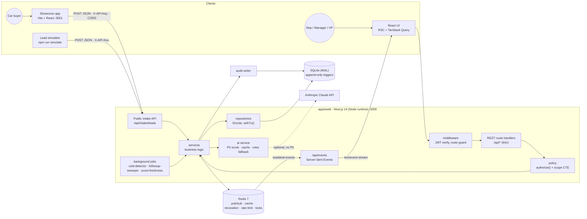
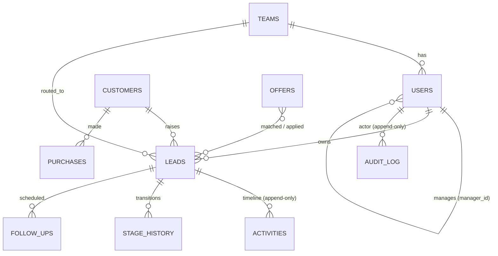
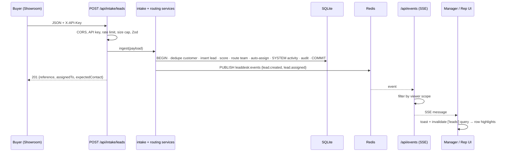

# EuroDrive Lead Desk: System Design Document

> **Scenario:** Sales Lead Management Tool for a European car dealership group
> **Author:** Rahul Nagubandi · **Version:** 1.0 · **Date:** 2026-10-01
> **Chosen layer:** **Backend** (REST API + persistent SQLite database), fully implemented. The frontend is also built as a working Next.js UI rather than a stub. A separate **showroom app** and a **CLI simulator** act as external clients of the public intake API, and the [README](../README.md#api-quick-reference-curl) has cURL examples.

This document is the summary for evaluators. The detailed source specs live in [`docs/00–04`](00-overview.md) and the 20 feature specs in [`docs/features/`](features/README.md).

---

## 1. Problem and Scope

Leads come into "EuroDrive Motors" from the website, social ads, portals, phone calls and walk-ins. Reps miss follow-ups, managers can't see their team's workload, and VPs can't see the funnel.

| Mandatory requirement | How it is met |
|---|---|
| **R1 Lead Inbox**: list all incoming leads | `GET /api/leads`: filters, search, saved views, priority ranking, server-side pagination, scoped by role |
| **R2 Lead Details**: full details plus a chronological log of activities | `GET /api/leads/:id` and `GET /api/leads/:id/activities`: one round trip for the detail view, keyset-paginated timeline |
| **R3 Activity Logging**: log a follow-up activity and persist it | `POST /api/leads/:id/activities`: Zod-validated, idempotent, transactional, append-only (enforced by DB triggers) |

Built beyond the mandatory scope: JWT auth, a Rep → Manager → VP hierarchy with RBAC, a stage pipeline, follow-ups and going-cold detection, explainable lead scoring, intake with dedupe and auto-routing, live updates over SSE, customer channel preferences, offers, dashboards, demographics, AI assist and an audit log.

---

## 2. Architecture Diagram



**Layering rule (enforced by convention, review and path ownership):**

```
route handler → authenticate → Zod validate → policy.authorize() → service → repository → DB
```

Services never import Next.js APIs, so the core can be lifted out into a standalone service (Fastify, a worker, a queue consumer) without rewriting it.

---

## 3. Component Roles

| Component | Location | Role |
|---|---|---|
| **Web UI** | `apps/web/app`, `components/` | Staff-facing app: inbox, lead detail + timeline, pipeline kanban, dashboards, offers, team settings, audit. TanStack Query for data, invalidated by SSE events |
| **Middleware** | `apps/web/middleware.ts` | Verifies the JWT cookie at the edge and redirects unauthenticated page requests to `/login` |
| **Route handlers** | `apps/web/app/api/**` (38 routes) | Thin HTTP layer: parse, validate with Zod schemas from `packages/shared`, authorize, call one service, map `AppError` → JSON error shape |
| **Auth** | `server/auth/` | bcrypt passwords, JWT (HS256, 8 h) in an `httpOnly` cookie, revocation by `jti` in Redis, login rate limiting, `getCurrentUser()` |
| **Policy (RBAC)** | `server/policy/` | `authorize(user, action, lead)` plus a **recursive CTE** that computes the set of users a person can see (rep → self; manager → team; VP → org). The same scope function backs both list and detail, so they can't disagree |
| **Services** | `server/services/` | All business logic, one file per domain: `lead-query`, `lead-detail`, `activity`, `stage`, `followup`, `scoring`, `intake`, `routing`, `dedupe`, `assignment`, `offer-matcher`, `dashboard`, `demographics`, `ai/`, `audit` |
| **Repositories / DB** | `server/db/` | Drizzle schema (10 tables), migrations, seed, `withTx()` for multi-row writes, append-only triggers on `activities` and `audit_log` |
| **Shared contracts** | `packages/shared` | Zod schemas, enums, event types, the stage state machine, scoring weights and formatters. The **only** code shared between web and showroom, so client and server validate with the same definitions |
| **Event bus** | `server/events/bus.ts` | Publishes domain events to Redis `leaddesk:events`. Falls back to an in-process `EventEmitter` if Redis is down |
| **SSE endpoint** | `app/api/events` | One stream per browser tab. Filters each event by the viewer's scope before sending it, with heartbeat, replay and resync |
| **Background jobs** | `server/jobs/` | `cold-detector` (60 s), `followup-sweeper` (60 s), `score-freshness` (5 min). Started once from `instrumentation.ts`, each guarded by a Redis lock so multiple instances don't double-run |
| **Intake API** | `app/api/intake/leads` | Public lead entry point: API key, CORS allowlist, rate limit (60/min), 10 KB cap, honeypot, idempotency key, dedupe by phone/email, then routing and auto-assign |
| **AI assist** | `server/services/ai/` | Summary, next best action and draft message. PII is scrubbed before any prompt, output is Zod-validated, responses are cached by context fingerprint, and a **deterministic rule-based fallback** runs when there is no key or the API fails |
| **Showroom app** | `apps/showroom` | A mock dealer website that posts real leads to the intake API. Demonstrates a genuine integration boundary |
| **Simulator** | `apps/web/scripts/simulate.ts` | CLI client that streams realistic leads into the intake API (`npm run simulate -- --count 5`) |

---

## 4. Data Model (summary)



Conventions: money is stored as **integer euro cents** and time as **UTC unix ms**, formatted only at the rendering edge. IDs are ULIDs (sortable, so they work as keyset cursors). `leads.version` gives optimistic concurrency for stage and owner changes. Full table definitions are in [03-domain-model.md](03-domain-model.md).

---

## 5. Data Flows

### 5.1 New lead: showroom → inbox in under 2 seconds



### 5.2 Read path: inbox (R1) and lead detail (R2)
1. The browser calls `GET /api/leads?view=mine&stage=NEW,CONTACTED&page=1`.
2. The handler authenticates from the cookie and validates the query with `LeadListQuerySchema`.
3. `lead-query` builds **one** SQL statement: the scope predicate from the policy CTE, filters, full-text search, and priority ranking (score, SLA breach, due follow-ups). Owner, customer and next follow-up are joined in, so there is **no N+1**.
4. Lead detail loads the lead, customer, owner, open follow-ups and the first page of the timeline in one service call. The timeline merges user activities, system events and stage changes, ordered by `occurred_at`.

### 5.3 Write path: log an activity (R3)
1. The composer posts `{clientRequestId (ULID), type, outcome, note, nextFollowUp?, stageChange?, expectedVersion}`.
2. The same Zod schema runs in the browser and on the server. Rules include: an outcome is required for contact types, a note can't have an outcome, follow-ups must be between 1 minute and 90 days out, and control characters are stripped.
3. `authorize(user, 'activity.create', lead)`.
4. A single transaction inserts the activity, optionally completes or creates a follow-up, optionally advances the stage (validated by the shared state machine plus a version check), re-scores the lead and writes the audit row.
5. **Idempotency:** a replay of the same `clientRequestId` within 10 minutes returns the original result rather than a duplicate, which makes double-clicks and retries safe.
6. After commit, publish `activity.created`. Other open tabs refresh through SSE.

### 5.4 Background flow
The jobs look for leads with no contact for `AT_RISK_DAYS` (marked at-risk) and for `COLD_AFTER_DAYS` or repeated unanswered attempts (moved to COLD through the stage service). They mark follow-ups MISSED 24 h past due and periodically refresh the time-decayed scores of young leads. Every change goes through the same services, so it's audited and published like a user action.

---

## 6. Technology Choices

| Concern | Choice | Why | Alternative considered |
|---|---|---|---|
| Language | **TypeScript (strict)** end to end | One type system from DB row to React prop; shared Zod contracts | — |
| Web/API framework | **Next.js 14 App Router** (Node runtime) | UI and REST API in one deployable; server components for read-heavy pages; simple same-origin cookie auth | Vite SPA + Express (two deployables, CORS for staff traffic) |
| Database | **SQLite (WAL) via better-sqlite3** | Zero-ops, fast synchronous reads, real transactions and triggers; the data is relational and read-heavy | Postgres (the documented scale path; Drizzle makes it a driver swap) |
| ORM / migrations | **Drizzle ORM + drizzle-kit** | SQL-shaped, typed, no runtime magic; easy to read generated queries | Prisma (heavier, less control over SQL) |
| Validation | **Zod** in `packages/shared` | One schema validates the browser form, the API request and the showroom payload | Hand-written validators |
| Cache / messaging | **Redis 7** (`ioredis`) | Pub/sub fan-out across instances, token revocation with TTL, rate limits, job locks, cache-aside | In-memory only (doesn't survive scale-out) |
| Live updates | **Server-Sent Events** | Updates only flow server → client; plain HTTP, auto-reconnect, works through proxies | WebSockets (bidirectional isn't needed), polling |
| Auth | **jose (JWT HS256) + bcryptjs**, `httpOnly` cookie | Stateless, XSS-resistant, easy to explain; Redis revocation as an escape hatch | Auth.js (more magic), localStorage tokens (XSS risk) |
| UI | **Tailwind + shadcn/ui (Radix)**, TanStack Query/Table, Recharts | Accessible primitives, fast iteration, cache invalidation that fits SSE | MUI (heavier theming) |
| AI | **Anthropic Claude** (`claude-opus-5-5`, effort `low`, configurable) | High-quality drafts and summaries; low effort keeps UI latency acceptable; the rules fallback keeps the demo deterministic | No AI, or a local model |
| Scoring | **Rule-based, explainable (0–100)** | No training data yet; reps can see *why* a lead is hot; it becomes the baseline an ML model must beat | ML model |
| Tests | **Vitest** (unit + integration on a real SQLite file), **Playwright** (e2e) | Fast; integration tests hit real route handlers and SQL | Jest |
| Monorepo | **npm workspaces** | Shared contracts with no build tooling overhead | Turborepo/Nx (unneeded at this size) |

Architecture decision records with alternatives are in [04-architecture.md §8](04-architecture.md#8-architecture-decision-records-summary).

---

## 7. Building for the Future

| Quality | What is in place | Scale path |
|---|---|---|
| **Scalability** | Stateless web tier (JWT, no server sessions). Redis pub/sub already fans events out across instances. Jobs take distributed locks. Keyset pagination on timelines | SQLite → Postgres (Drizzle driver swap) · N web instances behind a load balancer · jobs → BullMQ workers · read replica or materialized aggregates for dashboards |
| **Performance** | Single-query inbox with composite indexes such as `(owner_id, stage)`, `(team_id, owner_id)`, `(priority, score)` and `(lead_id, created_at)` · no N+1 on hot paths · scope computed once per request · cache-aside for active offers · AI responses cached by context fingerprint · targets: inbox and detail p95 < 300 ms on 800+ seeded leads | Redis cache for dashboard aggregates (the F20 strategy compares cache-aside with versioned keys and event-driven invalidation) |
| **Reliability** | Multi-row writes in one transaction (`withTx`) · optimistic concurrency (`leads.version`) · idempotent activity and intake writes · **graceful degradation**: Redis down → cache falls through to the DB, pub/sub → in-process emitter, rate limit → in-memory; Anthropic down → rule-based AI. The app never hard-fails on an external dependency | Outbox table for guaranteed event delivery · health and readiness endpoints for orchestration |
| **Security** | `authorize()` on every lead-scoped endpoint (UI hiding is never treated as authorization) · RBAC tests per endpoint · generic login errors · SameSite cookie, Origin check, JSON-only mutations · intake API key, CORS allowlist, rate limit, honeypot · **no PII in logs or AI prompts** | SSO/OIDC · secrets manager · GDPR consent, retention and erasure module |
| **Maintainability** | Strict layering · one service per domain · shared contracts · **path ownership per feature** (20 specs, each owning distinct files) · append-only "slot" registry on the lead detail page so features add cards without editing each other · ESLint `--max-warnings 0`, strict `tsc` · 1,236 unit/integration tests and 16 Playwright e2e specs | Extract `server/` into its own service when a second consumer appears |
| **Traceability** | Activities and the audit log are append-only, **enforced by SQLite triggers** (`RAISE(ABORT)` on UPDATE/DELETE), so even a bug or manual SQL can't rewrite history. The audit UI shows before/after diffs | Ship the audit log to immutable storage (WORM/S3 Object Lock) |

---

## 8. Observability Strategy

The guiding principle is that every signal must be **safe to keep** (no PII), **correlatable** (a request id on everything) and **actionable** (tied to an SLO or a business question).

### 8.1 Implemented today

| Signal | Implementation |
|---|---|
| **Structured request logs** | `server/http/logger.ts` writes one JSON line per request: `{level, route, userId, status, ms, requestId}`. The function destructures its argument, so extra fields such as email or phone **can't** leak into logs by accident. It is currently wired into the inbox route (`/api/leads`); rolling it out to every route through `withAuthz()` is the next step |
| **Error logs** | `toErrorResponse()` maps every error to a stable JSON shape `{error:{code,message,fields?}}` and never leaks stack traces. Unexpected errors log `{level:'error', requestId, message}` and return `Internal server error (ref <requestId>)`, so a user can quote the reference in a support ticket and it maps to exactly one log line |
| **Dependency health** | At startup the app logs `Redis: connected | degraded`. Degraded paths log a warning (for example `[auth] Redis degraded: revocation check skipped`), so a silent fallback is still visible |
| **Business audit trail** | Every mutation (stage change, assignment, offer edit, AI-assisted message, etc.) writes an `audit_log` row with actor, entity, action and a before/after diff. VPs and managers can browse it in `/audit`, scoped by RBAC |
| **Domain events** | Every state change emits a typed event on `leaddesk:events`. This stream is the natural tap for metrics and analytics |
| **AI quality** | `npm run eval:ai -w apps/web` runs a golden set of synthetic leads through the AI service and reports schema validity, language match and latency. PII scrubbing is covered by unit tests (`tests/unit/ai/scrub.test.ts`). Thumbs up/down feedback on each AI result is emitted as a structured log line (lead id, kind, fingerprint, vote, never the content), ready to aggregate into a quality metric |
| **Job visibility** | Each job run logs a JSON line with the job name, its result counts and `durationMs`; failures log at `error` level. A Redis lock prevents silent double runs |

### 8.2 Production plan

| Pillar | Plan |
|---|---|
| **Logs** | Ship the JSON stdout to Loki or ELK. Keep the `requestId` in `AsyncLocalStorage` so service and repository logs inherit it automatically. Retention: 30 days for app logs; the audit log is kept indefinitely |
| **Metrics (Prometheus / OpenTelemetry)** | *RED per route:* request rate, error rate and p50/p95/p99 latency. *Saturation:* SQLite busy/locked count, Redis memory and evictions, number of SSE connections, event-loop lag. *Business:* leads ingested per source, time to first contact, SLA breaches, leads going cold, conversion by stage, AI fallback rate and AI latency |
| **Tracing (OpenTelemetry)** | Use `@vercel/otel` / the OTel Node SDK in `instrumentation.ts`. Spans: HTTP → `authorize` → service → SQL (Drizzle) → Redis → Anthropic. Propagate `traceparent` from the showroom through intake so one trace covers buyer submit → inbox toast |
| **SLOs and alerts** | Inbox and detail p95 < 300 ms · intake success rate > 99.5% · intake → SSE delivery < 2 s · alert on error rate > 1% for 5 min, Redis degraded > 5 min, AI fallback rate > 20%, or job lock held > 10 min |
| **Dashboards** | One operations dashboard (RED, saturation, dependency health) and one product dashboard (funnel, SLA, rep workload), the latter already partly in-app at `/dashboard` |

---

## 9. How GenAI Was Used in the Design Phase

I used **Claude Code (Claude Opus)** as a design partner and **GitHub Spec Kit** as the structure that turned design into buildable work. The approach was *spec-first*: no code was written until the complete product spec existed.

1. **Requirements expansion.** I gave Claude the three mandatory requirements plus my own scope ideas (hierarchy, channels, offers, live intake, dashboards). Claude drafted personas, jobs-to-be-done and end-to-end user flows. I then cut, merged and prioritized them into P0/P1/P2 tiers so the mandatory R1–R3 could never be blocked by optional features.
2. **Decision interrogation.** For every major choice (SQLite vs Postgres, SSE vs WebSockets, JWT vs sessions, rule-based vs ML scoring, Claude with a fallback) I asked Claude for alternatives and trade-offs, then recorded my decision as an ADR. One decision, the caching technique (F20), was deliberately left *pending*: Claude compared cache-aside, versioned keys and event-driven invalidation, and I chose to defer it rather than accept a premature recommendation.
3. **Domain model and state machine.** Claude proposed the entity model, the stage state machine and the event catalog. I tightened the constraints (integer cents, UTC ms, append-only activities enforced by triggers, optimistic version column) and made the schema owned by a single foundation feature, F01.
4. **Designing for parallel AI builds.** The biggest design decision was shaped by GenAI itself. I split the product into **20 feature specs across 5 dependency waves**, each with an explicit **path-ownership** table and sanctioned "append-only" extension points (the slot registry, the dashboard tab registry). That let several Claude sessions implement features **in parallel git worktrees** without merge conflicts.
5. **A constitution as guardrails.** The non-negotiable rules (authorize every endpoint, append-only, transactions, money in cents, graceful degradation, no N+1, no PII to AI) were written into a Spec Kit constitution, so every generated plan was checked against them by `/speckit-analyze`.
6. **Human review.** I reviewed every spec before implementation, answered the clarifications Claude couldn't resolve from the docs, and rejected or rewrote sections that over-engineered the demo (for example real WhatsApp/Twilio integration became deep links behind a `ChannelAdapter` interface).

The AI collaboration during *implementation and verification* is described in the [README's AI Collaboration Narrative](../README.md#ai-collaboration-narrative).

---

## 10. Known Limitations and Trade-offs

- **SQLite is single-writer.** It's fine for one dealership group and a demo, but multi-region write traffic needs Postgres.
- **Caching is intentionally minimal** (active offers, AI responses). The broader dashboard caching strategy (F20) is specified but its technique is still a pending decision.
- **Outbound messaging is simulated** with deep links (`wa.me`, `tel:`, `sms:`, `mailto:`) plus auto-logging. Real WhatsApp Business and Twilio integrations plug into `ChannelAdapter`.
- **Metrics and tracing are designed, not deployed.** Today's observability is structured logs, the audit log and degraded-mode signals (§8.1).
- **GDPR tooling** (consent, export, erasure) is a known requirement for the EU market and is listed as future work.
