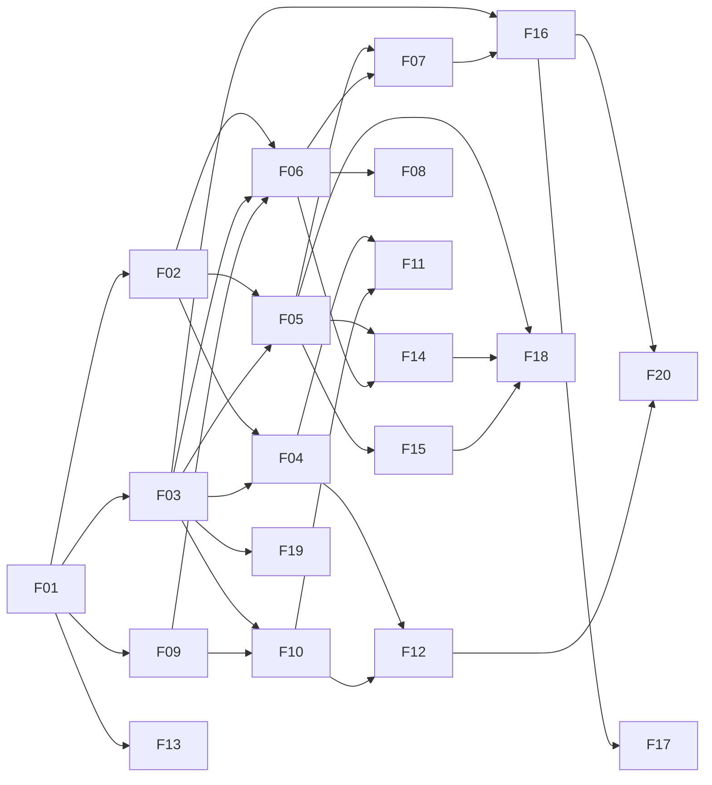

# Feature Index & Build Waves

Every feature spec follows `_TEMPLATE.md`. Features in the same **wave** can be built **in parallel** by separate Claude/Spec Kit runs. They only depend on earlier waves, and their **owned paths** don't overlap.

## Feature List
| ID | Feature | Priority | Wave | Depends on | Req. |
|---|---|---|---|---|---|
| [F01](F01-platform-foundation.md) | Platform Foundation: monorepo, schema, shared contracts, seed, Redis, app shell | P0 | 0 | — | — |
| [F02](F02-authentication.md) | Authentication & Sessions | P0 | 1 | F01 | — |
| [F03](F03-hierarchy-rbac.md) | Org Hierarchy, Scope & RBAC Policy | P0 | 1 | F01 | — |
| [F09](F09-lead-scoring.md) | Lead Scoring & Priority | P1 | 1 | F01 | — |
| [F13](F13-showroom-app.md) | Showroom Mini App (lead generation) | P1 | 1 | F01 (shared intake contract) | — |
| [F04](F04-lead-inbox.md) | Lead Inbox | P0 | 2 | F02, F03 | **R1** |
| [F05](F05-lead-detail-timeline.md) | Lead Detail & Timeline | P0 | 2 | F02, F03 | **R2** |
| [F06](F06-activity-logging.md) | Activity Logging | P0 | 2 | F02, F03, F09 | **R3** |
| [F10](F10-lead-intake-routing.md) | Lead Intake, Dedupe, Routing & Auto-assign, Simulator | P1 | 2 | F03, F09 | — |
| [F07](F07-stage-pipeline.md) | Stage Pipeline, Won/Lost, Kanban | P1 | 3 | F05, F06 (soft: F15 offer picker in the won dialog, stubbed until F15 merges) | — |
| [F08](F08-follow-ups-cold.md) | Follow-ups & Going-Cold Detection | P1 | 3 | F06, F07 (auto-COLD calls the stage service; stub the interface until F07 merges), F09 (schedules `recomputeFreshScores()`) | — |
| [F11](F11-assignment-management.md) | Claim, Manual Assign & Auto-assign Settings | P1 | 3 | F04, F10 | — |
| [F12](F12-live-updates.md) | Live Updates (SSE + Redis pub/sub) | P1 | 3 | F04, F10 | — |
| [F14](F14-customer-channels.md) | Customer Profile, Preferences & Channel Deep Links | P1 | 3 | F05, F06 | — |
| [F15](F15-offers.md) | Offers Management & Matching | P1 | 3 | F05 | — |
| [F16](F16-dashboards.md) | Manager & VP Dashboards | P1 | 4 | F03, F07 | — |
| [F17](F17-demographics.md) | Demographics Analytics | P2 | 4 | F16 | — |
| [F18](F18-ai-assist.md) | AI Assist: summary, next best action, draft message | P1 | 4 | F05, F14, F15 | — |
| [F19](F19-audit-log.md) | Audit Log & Traceability UI | P2 | 4 | F03 | — |
| [F20](F20-caching-strategy.md) | Caching Strategy (Redis), **decision pending** | P1 | 4 | F16, F12 | — |

## Dependency Graph

## Build Waves
| Wave | Parallel streams | Gate to next wave |
|---|---|---|
| **0** | F01 (single stream, it's the foundation) | `npm run db:reset && npm run dev` works, shell renders, seed loaded, Redis connects or degrades |
| **1** | F02 · F03 · F09 · F13 | Login works. `scopeFor(user)` is tested. `scoreLead()` is tested. Showroom form validates against the shared contract |
| **2** | F04 · F05 · F06 · F10 | **Mandatory R1–R3 demoable.** Intake API creates and assigns leads |
| **3** | F07 · F08 · F11 · F12 · F14 · F15 | Live showroom-to-inbox demo works |
| **4** | F16 · F17 · F18 · F19 · F20 | Full demo script passes |

**Deadline mode:** if time runs short, stop after wave 2 plus F12 and F13. That already covers every mandatory item plus the headline live-lead demo.

## Path Ownership (prevents merge conflicts between parallel runs)
| Feature | Owns |
|---|---|
| F01 | root configs, `docker-compose.yml`, `packages/shared/**` (initial, incl. `stage-machine.ts`, `source-groups.ts`, schemas, events), `apps/web/server/db/**` (incl. `audit.ts` writer and append-only triggers), `apps/web/server/redis/**`, `apps/web/server/http/**`, `apps/web/server/events/bus.ts`, `apps/web/server/cache/cache.ts` (interface + no-op/basic impl), `apps/web/lib/format.ts`, `apps/web/app/layout.tsx`, `apps/web/components/layout/**`, `apps/web/components/ui/**`, `app/api/leads/[id]/activities/route.ts` (delegating scaffold + 501 handler stubs), `apps/showroom` scaffold |
| F02 | `apps/web/server/auth/**`, `app/(auth)/**`, `app/api/auth/**`, `middleware.ts` |
| F03 | `apps/web/server/policy/**` |
| F09 | `apps/web/server/services/scoring.ts`, `packages/shared/src/scoring.ts` |
| F13 | `apps/showroom/src/**` |
| F04 | `app/(app)/inbox/**`, `components/leads/inbox/**`, `app/api/leads/route.ts`, `server/services/lead-query.ts` |
| F05 | `app/(app)/leads/[id]/page.tsx` + layout (with **slots** for composer, channels, offers, AI, follow-ups), `components/leads/detail/**` (incl. `slots.tsx`), `components/timeline/**`, `app/api/leads/[id]/route.ts` (GET), `app/api/leads/[id]/activities/handlers/get.ts`, `server/services/lead-detail.ts` |
| F06 | `components/leads/composer/**`, `app/api/leads/[id]/activities/handlers/post.ts`, `server/services/activity.ts`, `packages/shared/src/schemas/activity.ts` (append-only) |
| F07 | `server/services/stage.ts`, `app/(app)/pipeline/**`, `components/leads/stage/**`, PATCH stage endpoint (consumes F01's `stage-machine.ts`, append-only) |
| F08 | `packages/shared/src/followup-rules.ts`, `server/services/followup.ts`, `server/jobs/**` (incl. scheduling F09's `recomputeFreshScores()`), `components/followups/**`, follow-up endpoints |
| F10 | `app/api/intake/**`, `server/services/{intake,routing,dedupe}.ts`, `apps/web/scripts/simulate.ts` |
| F11 | `server/services/assignment.ts`, `app/(app)/team/settings/**`, claim/assign endpoints, `components/leads/assign/**` |
| F12 | `app/api/events/**`, `lib/sse/**`, `components/live/**` (toasts, row highlight) |
| F14 | `server/channels/**`, `components/leads/customer/**`, `components/leads/channels/**` |
| F15 | `server/services/offer-matcher.ts`, `app/(app)/offers/**`, `app/api/offers/**`, `components/offers/**` |
| F16 | `server/services/dashboard.ts`, `app/(app)/dashboard/**`, `app/api/dashboard/**`, `components/dashboard/**` (incl. the tab registry `tabs.ts`), `packages/shared/src/source-groups.ts` (mapping content; F01 ships the initial file for F04, and F16 may append) |
| F17 | `components/dashboard/demographics/**`, demographics queries in `server/services/demographics.ts` |
| F18 | `server/services/ai/**`, `app/api/leads/[id]/ai/**`, `components/leads/ai/**` |
| F19 | `server/services/audit.ts` (the writer is F01's `server/db/audit.ts`; this feature adds the query and UI), `app/(app)/audit/**` |
| F20 | `server/cache/**` (full strategy), cache wiring PRs into the services it names |

### Ownership exceptions (sanctioned cross-owner edits)
| File | Owner | Who else may touch it, and how |
|---|---|---|
| `components/leads/detail/slots.tsx` | F05 | F06 (composer), F08 (follow-up card), F14 (customer/channels), F15 (offers), F18 (AI card), F19 (audit link): **append-only** registrations |
| `components/leads/inbox/live-slot.ts` | F04 | F12 replaces the **body only** of `useInboxLive()` (the signature stays) |
| `server/db/seed/score-step.ts` | F01 | F09 replaces the **body only** of the stub with `scoreLead()` |
| `app/api/leads/[id]/activities/route.ts` | F01 | Nobody. It delegates to `handlers/get.ts` (F05) and `handlers/post.ts` (F06), which replace F01's 501 stubs |
| `server/jobs/**` | F08 | F08 schedules F09's `recomputeFreshScores()` (F09 owns the function, F08 the job) |
| `packages/shared/src/stage-machine.ts` | F01 | F07 may append helpers |
| `packages/shared/src/source-groups.ts` | F01 (file) / F16 (mapping content) | F16 may append groups |
| `components/dashboard/tabs.ts` | F16 | F17 appends the Demographics tab |
| `server/cache/cache.ts` | F01 (primitives) | F20 extends it into the full strategy |

**Same-wave soft dependencies:** code against the interface named in the depended-on spec and stub it. The real implementation replaces the stub at merge time. Pairs: F08→F07 (`changeStage`), F07→F15 (`matchOffers`).

Shared files that several features touch (for example the nav menu or `packages/shared` additions) must be **append-only**. Any schema change goes through a migration and an update to `03-domain-model.md`.
